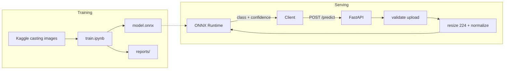
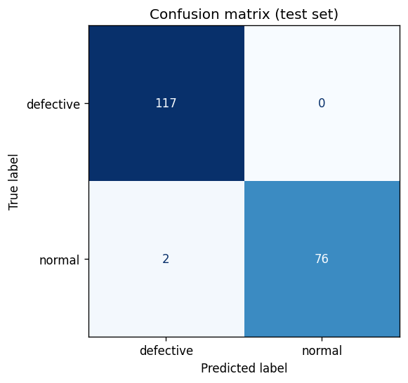
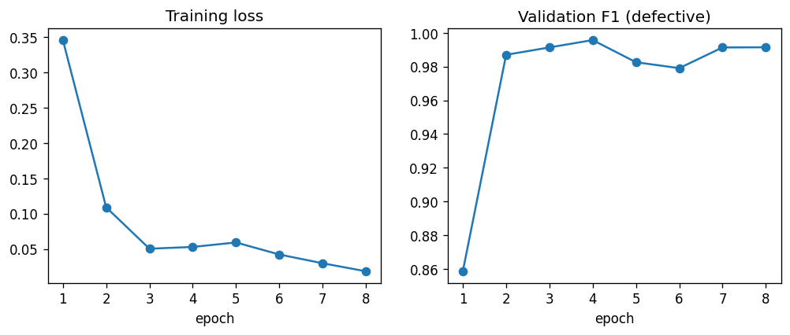
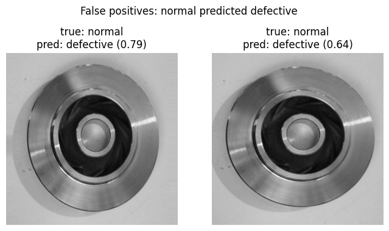
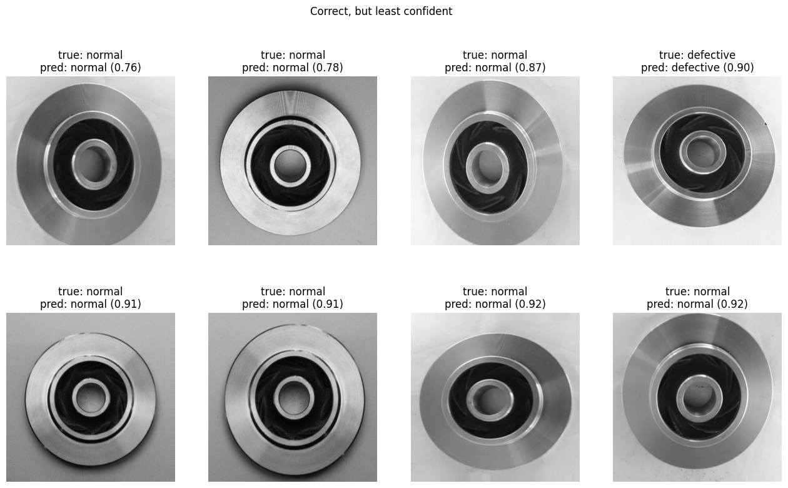

# Defect Detection

Binary classifier for casting product images (defective / normal) with a FastAPI inference service.

ResNet18 fine-tuned on the Kaggle casting dataset, exported to ONNX and served with ONNX Runtime in Docker.

## Architecture



## Files

```
train.ipynb        training and evaluation
app.py             inference API
test_app.py        API tests
requirements.txt   API dependencies
Dockerfile
model.onnx         trained model
reports/           metrics and plots
examples/          sample images and API responses
```

## Setup

Docker:

```bash
docker build -t defect-api .
docker run -p 8000:8000 defect-api
```

Without Docker (Python 3.10 to 3.12):

```bash
pip install -r requirements.txt
uvicorn app:app --port 8000
```

Request:

```bash
curl -X POST http://localhost:8000/predict -F "file=@examples/defective.jpeg"
```

```json
{"predicted_class": "defective", "confidence": 1.0}
```

Swagger docs at `http://localhost:8000/docs`, health check at `GET /health`.

| Case | Status |
|---|---|
| valid image | 200 |
| not an image, empty or unreadable file | 400 |
| no file | 422 |
| file over 5 MB | 413 |
| inference error | 500 |

Each request is logged with filename, predicted class, confidence and latency.

Tests:

```bash
pip install pytest httpx
pytest -q
```

A GitHub Actions workflow builds the image on every push, starts the container and checks a prediction.

## Training

Open `train.ipynb` in Colab with a T4 GPU and run all cells (about 5 minutes). The last cells test the API, so upload `app.py` and `test_app.py` to the Colab session first. Outputs are `model.onnx`, `reports/` and `examples/`.

## Dataset

[Casting product image data for quality inspection](https://www.kaggle.com/datasets/ravirajsinh45/real-life-industrial-dataset-of-casting-product): top-down images of submersible pump impellers, labelled `def_front` and `ok_front`.

- Used the 1,300 original 512x512 images (781 defective, 519 normal). The 7,348-image 300x300 version is already augmented, so augmented copies of the same part could end up in both train and test.
- Checked class counts, image sizes and modes, and removed exact duplicates by file hash (none found).
- Stratified 70/15/15 split with a fixed seed: 910 train, 195 validation, 195 test.
- Preprocessing: resize to 224x224, ImageNet mean/std normalization.
- Augmentation on train only: horizontal/vertical flip, rotation up to 15 degrees, brightness/contrast jitter. The part is round and photographed from above, so these don't change the label.
- Class imbalance (60/40) handled with class weights in the cross-entropy loss.

## Model

ResNet18 pretrained on ImageNet, final layer replaced with a 2-class head, all layers fine-tuned. Adam, lr 1e-4, batch 32, 8 epochs, best epoch picked on validation F1 for the defective class.

With about 900 training images, training from scratch isn't realistic, and pretrained features transfer well to surface defects. ResNet18 is small (11M parameters, 45 MB) and fast on CPU, which is enough for a binary task on a fixed camera view. A bigger backbone would add latency without much to gain here.

The API uses ONNX Runtime instead of PyTorch, which keeps the Docker image small and CPU inference fast. ONNX and PyTorch predictions were compared on the test set and match.

## Results

Test set, 195 images (117 defective, 78 normal):

| Class | Precision | Recall | F1 | Support |
|---|---|---|---|---|
| defective | 0.983 | 1.000 | 0.992 | 117 |
| normal | 1.000 | 0.974 | 0.987 | 78 |

Accuracy 0.990. 0 false negatives, 2 false positives.

Model size 44.7 MB. Inference 32.6 ms per image on Colab CPU; a full API request was around 250 ms on an older Intel laptop.





Recall on the defective class is the metric that matters most: a false negative means a defective part gets shipped, a false positive means a good part gets re-inspected.

0 misses out of 117 doesn't mean the miss rate is zero. At this sample size the true miss rate could still be up to about 2.5% (95% confidence). Validation F1 differences between epochs are within noise, since one error on 195 images moves F1 by about 0.4 points.

## Error analysis

No false negatives on the test set.



Both false positives are normal parts predicted defective with low confidence (0.79 and 0.64). Both are tilted, with a strong reflection on the machined face and a hard shadow, so the model seems to react to lighting rather than an actual defect. The two images look like the same part photographed twice, so the dataset has near-duplicates that a hash check doesn't catch.



7 of the 8 least confident correct predictions are normal parts (0.76 to 0.92), with the same tilt and highlights. The model leans towards "defective" under unusual lighting. That's the safer direction for QC but would mean extra manual re-inspection on a real line.

## Example predictions

| Image | Label | Response |
|---|---|---|
| `examples/defective.jpeg` | defective | `{"predicted_class": "defective", "confidence": 1.0}` |
| `examples/normal.jpeg` | normal | `{"predicted_class": "normal", "confidence": 0.9983}` |

## Trade-offs

- ResNet18 vs a larger model: lower latency and smaller file, less capacity for very subtle defects.
- 224x224 input vs 512x512: about 5x fewer pixels, but small defects can get lost when downscaling.
- Classification vs segmentation: only needs image-level labels, but doesn't localize the defect.
- Fixed 0.5 threshold: simple, not tuned to the cost of a missed defect.

## Limitations

- One product, one camera angle, one lighting setup. A new product or lighting change needs new data.
- No part IDs in the dataset, so photos of the same part can end up in different splits. The test score is probably a bit optimistic.
- Real lines have far fewer defects than 60/40, so precision would be lower in production at the same threshold.
- Confidence is a softmax output, not a calibrated probability.
- No defect localization, auth, rate limiting or drift monitoring.
- Check the dataset license on Kaggle before any commercial use.

## Next steps

- Tune the decision threshold on validation data against the cost of a missed defect.
- Grad-CAM to show which region drives a prediction.
- Collect more normal parts under varied lighting.
- Send low-confidence predictions to manual review and add them to the training set.
